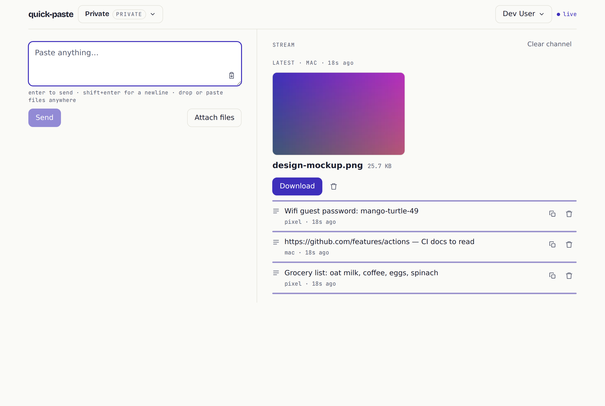
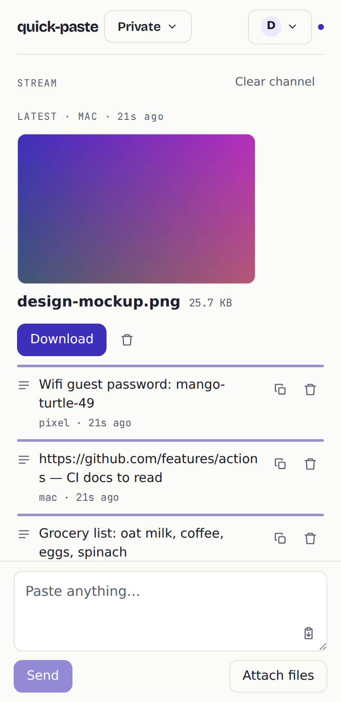

# quick-paste

Self-hosted, **multi-user** tool for moving **clipboard text** and **files**
between a small trusted group's devices (Mac, Android, iPad/iPhone, desktop)
through shared, ephemeral clipboard streams called **channels**. Installable
PWA, real-time WebSocket sync, web push, resumable uploads, and automatic
expiry — your clipboard never lives anywhere but your own box.

Two ways to run it:

- **With a domain** — behind a Cloudflare Tunnel, multi-user with Google sign-in.
- **On your home WiFi, no domain needed** — single-owner password sign-in
  (`QP_AUTH_MODE=local`); see below.

MIT licensed.

The full functional specification is the source of truth: [`quick-paste-SPEC.md`](./quick-paste-SPEC.md).

## Screenshots

The PWA — a real-time stream with a unified composer; the newest item is
emphasized, files show thumbnails, and everything works in light and dark:



| Dark mode | Mobile |
|---|---|
|  |  |

The browser extension — send the page selection / a link / an image / your
clipboard from any tab, and read recent history from the toolbar popup:

| Toolbar popup | Settings |
|---|---|
|  |  |

## Architecture at a glance

- **Server** (`server/`) — Micronaut 4 (Java 17), PostgreSQL (pgvector) + Flyway, Quartz TTL
  sweep, Micronaut WebSocket. Exposes REST + `/api/stream` WebSocket. Handles
  Google OIDC login (sessions) and per-user API tokens (automation); authorizes
  every operation by channel membership.
- **PWA** (`pwa/`) — Vite + React + TypeScript SPA, installable, service worker,
  channel switcher, Web Share Target, web push.
- **Browser extension** (`extension/`) — Chrome/Edge MV3 extension: send the
  selection / a link / an image / the clipboard from any tab, and read history
  from the toolbar popup. Authenticates with an API token; works against any
  instance. See [`extension/README.md`](./extension/README.md).
- **Mac helper** (`mac-helper/`, Phase 3) — Tauri menu-bar app with clipboard
  auto-capture / auto-write.
- **Proxy** — Caddy (`Caddyfile`) is the only published entry point; it
  reverse-proxies HTTP + WebSocket to the server, which is not exposed on the
  host (same pattern as the other stacks on this machine).
- **Edge** — Cloudflare Tunnel for ingress only (optional `tunnel` compose
  profile, `CLOUDFLARE_TUNNEL_TOKEN`), pointed at the Caddy proxy. **No
  Cloudflare Access**; the origin is the sole auth boundary.

Planned repo layout:

```
server/       # Micronaut backend (fat JAR)
pwa/          # Vite + React + TS PWA
extension/    # Chrome/Edge MV3 browser extension
mac-helper/   # Tauri menu-bar helper (Phase 3)
shortcuts/    # iOS Shortcut definitions / docs (Phase 2)
docker-compose.yml
```

## Getting started

### Easiest: the guided setup

If you have [Docker Desktop](https://www.docker.com/products/docker-desktop)
installed, download this project (green **Code** button → **Download ZIP**, then
unzip — or `git clone`), open a terminal in the folder, and run:

```bash
./setup.sh
```

It checks Docker, **generates the secrets for you**, asks how you want to sign
in (a password for home Wi-Fi, or Google for a public address), writes `.env`,
starts everything, and prints the address to open. You never touch a config
file. To skip the local build, set a prebuilt image first (see below).

### Manual

1. For Google sign-in, create an OAuth client (web) with redirect URI
   `<QP_PUBLIC_URL>/api/auth/callback` — or use password mode (no accounts; see
   "Run on your home WiFi").
2. Copy `.env.example` to `.env` and fill in values (see SPEC §11) — at minimum
   `QP_DB_PASS`, `QP_SESSION_SECRET`, and either `QP_AUTH_MODE=local` +
   `QP_LOCAL_PASSWORD`, or the Google client id/secret + `QP_ALLOWED_EMAILS`
   (first entry becomes admin) + `QP_PUBLIC_URL`.
3. Bring up the stack with `docker compose up -d --build` (PostgreSQL + server;
   the server image bundles the PWA and serves it at `/`).
4. Check `http://localhost:8080/health`, then sign in at `http://localhost:8080/`.

**Skip the build with a prebuilt image.** CI publishes the server image to
GitHub Container Registry. Set `QP_SERVER_IMAGE=ghcr.io/<owner>/quick-paste-server:latest`
in `.env` and `docker compose up -d` *pulls* it instead of building — no JDK or
build toolchain needed on your machine.

### Run on your home WiFi (no domain needed)

No FQDN, no Cloudflare, no Google setup — a single-owner instance on your LAN:

```bash
cp .env.example .env
# in .env set:
#   QP_AUTH_MODE=local
#   QP_LOCAL_PASSWORD=<pick a strong password>
docker compose up -d --build
```

**Use HTTPS (recommended).** Caddy serves `https://<host>:8443` with its own
local certificate. HTTPS is the right way to run on a LAN: it keeps your
session cookie and password off the wire, and it's *required* anyway for the
full app — install to home screen, web push, and the Android share target all
need a secure origin (plain HTTP only gets you basic text/file sync).

Trust the certificate on each device once — grab the root CA straight from the
server (one download, no `docker` needed):

```
open  http://<host>:8080/qp-ca.crt      # or: curl -O http://<host>:8080/qp-ca.crt
```

- **iOS:** open the file → install the profile (Settings → General → VPN &
  Device Management), then enable it under Settings → General → About →
  Certificate Trust Settings.
- **Android:** Settings → Security → Encryption & credentials → Install a
  certificate → CA certificate.
- **macOS:** open in Keychain Access → set to Always Trust.

Then open `https://<host>:8443` and sign in with your password.

**Tip:** use a stable *hostname*, not a raw IP — TLS is much smoother with a
name. A `.local` mDNS name (e.g. `https://mybox.local:8443`) or a line in each
device's `hosts` file works; Caddy mints the certificate for whatever name you
use.

**Enforce HTTPS.** Once the CA is trusted, set `QP_LAN_HTTPS_ONLY=true` in
`.env` and any plain-HTTP hit is bounced to HTTPS (localhost and the tunnel are
always exempt; the `/qp-ca.crt` download stays on HTTP so you can still fetch
it). Leave it `false` for a frictionless HTTP trial before you've trusted the
cert.

Notes for local mode: it is exactly one user (`owner@local`) — invites and
Google accounts are disabled; anyone with the password and WiFi access can read
the stream, so treat the password accordingly; login attempts are rate-limited.

### Local development (no Google needed)

```bash
# Terminal 1 — DB (host port 5433 to avoid clashing with a local Postgres on 5432)
docker run -d --name qp-dev-db -p 5433:5432 \
  -e POSTGRES_DB=quickpaste -e POSTGRES_USER=quickpaste \
  -e POSTGRES_PASSWORD=quickpaste pgvector/pgvector:pg17

# Terminal 2 — server (JDK 17+; QP_DEV_AUTH_BYPASS maps every request to a dev user)
cd server && QP_DEV_AUTH_BYPASS=true \
  QP_DB_URL=jdbc:postgresql://localhost:5433/quickpaste ./gradlew run

# Terminal 3 — PWA with hot reload (proxies /api → localhost:8080)
cd pwa && npm install && npm run dev   # http://localhost:5173
```

Backend tests use Testcontainers (Docker must be running): `cd server && ./gradlew test`.

## Status — what works today

- **Server** — Google OIDC + local-password auth, sessions, API tokens,
  channels + membership, text/file clips with dedup and idempotency, simple +
  resumable (tus) uploads with per-user quotas, image thumbnails, web push
  (VAPID), real-time WebSocket with gap-free catch-up, TTL sweep, account/admin
  lifecycle. 52 integration tests (Testcontainers PostgreSQL).
- **PWA** — installable, real-time, paste-anywhere, unified composer, single
  stream view, web push, Android Web Share Target.
- **Browser extension** — Chrome/Edge MV3: send from any tab (right-click /
  shortcut / popup) and read history.
- **iOS Shortcuts** — send + get-latest recipes in [`shortcuts/`](./shortcuts/).

**Planned, not yet built:** the Tauri **Mac menu-bar helper** (auto
capture/write — `mac-helper/` is a placeholder), per-channel end-to-end
encryption, and the v3 Library. See `quick-paste-SPEC.md` for the full
specification.

## Contributing & security

See [`CONTRIBUTING.md`](./CONTRIBUTING.md) to build and test locally, and
[`SECURITY.md`](./SECURITY.md) to report a vulnerability.
