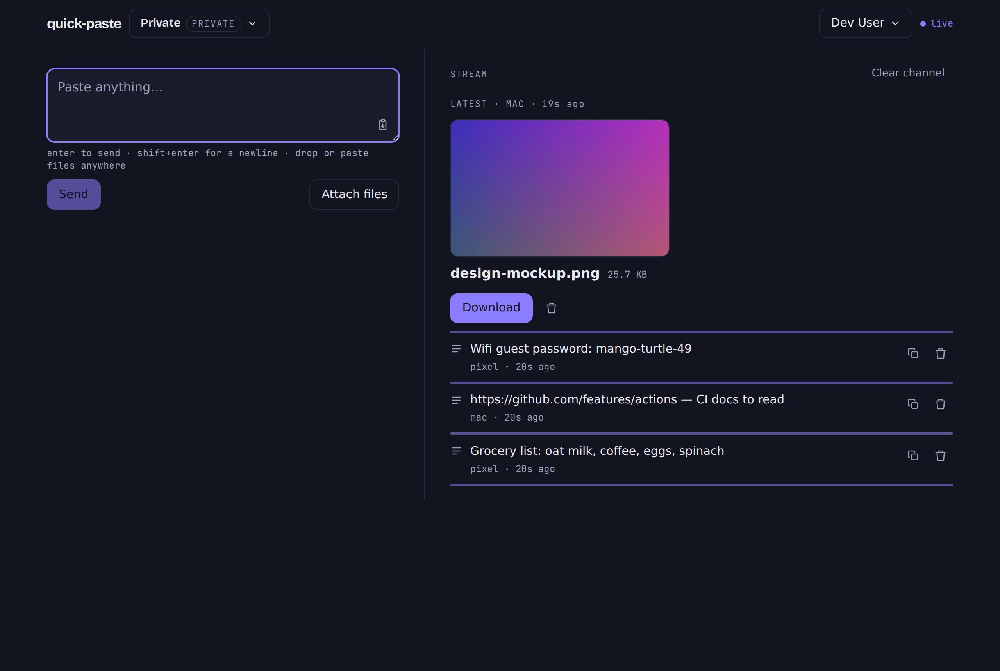
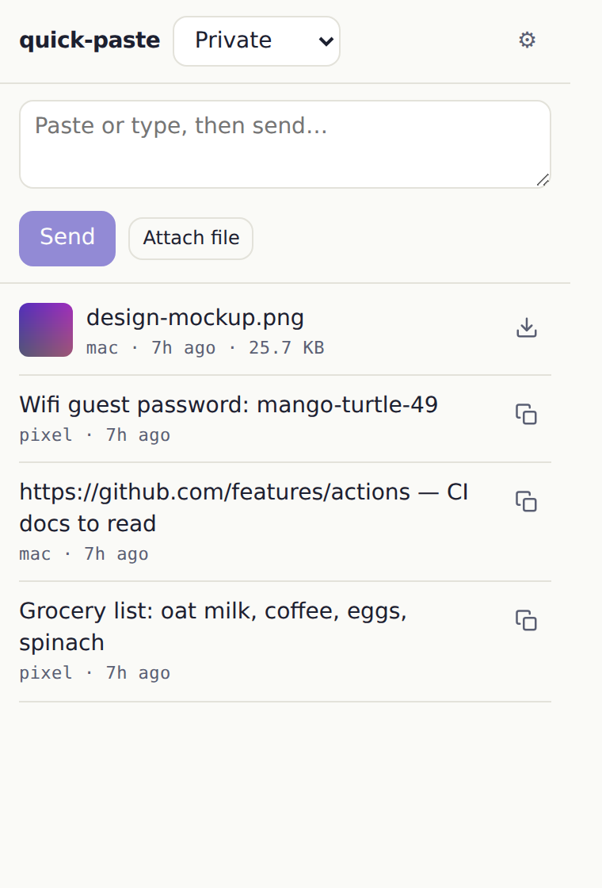
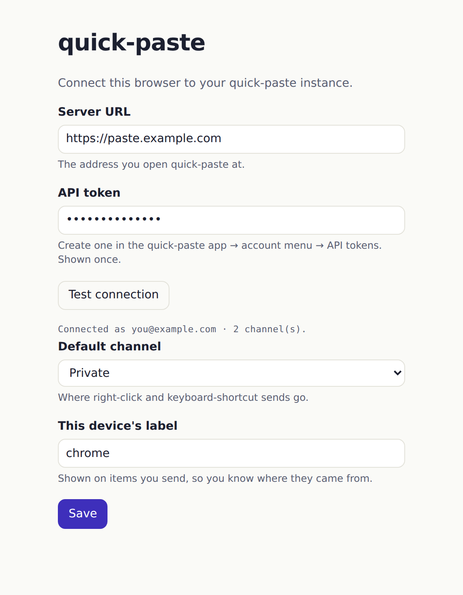

# quick-paste

Self-hosted tool for moving **clipboard text** and **files** between a small
trusted group's devices (phone, tablet, laptop) through shared, ephemeral
streams called **channels**.

Installable PWA, real-time WebSocket sync, web push, resumable uploads, and
automatic expiry — content stays on **your** machine.

**How you run it:** [Docker Desktop](https://www.docker.com/products/docker-desktop)
(or Docker Engine + Compose). There is no standalone `.dmg` / `.exe` server
installer; the stack is PostgreSQL + the app + a reverse proxy.

Two common setups:

| | Home Wi‑Fi | Public URL |
|---|---|---|
| Sign-in | Password (`QP_AUTH_MODE=local`) | Google |
| Domain | Not needed | Yes (e.g. Cloudflare Tunnel) |
| Users | Single owner | Multi-user (allowlist / invites) |

MIT licensed. Spec: [`quick-paste-SPEC.md`](./quick-paste-SPEC.md).

## Screenshots


| Dark mode | Mobile |
|---|---|
|  |  |

Browser extension — send selection / link / image / clipboard from any tab:

| Toolbar popup | Settings |
|---|---|
|  |  |

## Requirements

- [Docker Desktop](https://www.docker.com/products/docker-desktop) (Mac / Windows / Linux) **or** Docker Engine with the Compose plugin
- ~2 GB free disk for images + data
- For Google mode: a public HTTPS URL and a Google OAuth **Web** client

## Quick start (recommended)

1. Install and **start** Docker Desktop.
2. Get the code (`git clone` or Code → Download ZIP).
3. In a terminal, from the project folder:

```bash
./setup.sh
```

On Windows, use **WSL2** or Git Bash so the script can run.

`setup.sh` checks Docker, generates secrets, asks password vs Google, writes
`.env`, starts the stack, and prints the URL to open. You do not need to edit
config by hand.

**Faster first start (skip the local build):** after `.env` exists, set:

```bash
QP_SERVER_IMAGE=ghcr.io/vaibhavk81-git/quick-paste-server:latest
```

then `docker compose up -d` (or re-run `./setup.sh` and keep the existing
`.env`). CI publishes that image from `main`. If `docker pull` fails with
unauthorized, the GHCR package may still be private — build with
`docker compose up -d --build` instead.

### Day-2 commands

```bash
docker compose up -d          # start / restart
docker compose down           # stop (keeps data volumes)
docker compose logs -f server # follow server logs
docker compose pull && docker compose up -d   # update when using QP_SERVER_IMAGE
```

Data lives in Docker volumes (`qp-pgdata`, `qp-blobs`, …). Back up those (and
`.env`) if you care about retention — especially once you use lasting data.

## Home Wi‑Fi (password, no domain)

`./setup.sh` → choose **Password**. Or manually:

```bash
cp .env.example .env
# Set QP_AUTH_MODE=local and QP_LOCAL_PASSWORD=<strong password>
docker compose up -d --build
```

**Use HTTPS on other devices.** Caddy serves `https://<host>:8443` with a local
CA. PWA install, web push, and the Android share target need a secure origin.

1. On each device, download and trust the CA once:

   `http://<host>:8080/qp-ca.crt`

   - **iOS:** install the profile, then enable it under Settings → General →
     About → Certificate Trust Settings.
   - **Android:** Settings → Security → install a **CA** certificate.
   - **macOS:** open in Keychain Access → Always Trust.

2. Open `https://<host>:8443` and sign in with your password.

Prefer a hostname (e.g. `https://mybox.local:8443`) over a raw IP when you can.
After the CA is trusted, set `QP_LAN_HTTPS_ONLY=true` in `.env` to redirect plain
HTTP to HTTPS (localhost and the tunnel stay exempt; `/qp-ca.crt` stays on HTTP).

Local mode is **one** user (`owner@local`). Anyone on the Wi‑Fi with the
password can use the stream — pick a strong password.

## Public URL (Google sign-in)

1. Create a Google Cloud OAuth client (**Web application**) with redirect URI
   `<QP_PUBLIC_URL>/api/auth/callback`.
2. Run `./setup.sh` and choose **Google**, or copy `.env.example` → `.env` and
   set at least:

   - `QP_PUBLIC_URL` (https)
   - `QP_GOOGLE_CLIENT_ID` / `QP_GOOGLE_CLIENT_SECRET`
   - `QP_ALLOWED_EMAILS` (first email becomes admin)
   - `QP_DB_PASS`, `QP_SESSION_SECRET`
   - `QP_TRUSTED_PROXY_COUNT=2` if Cloudflare sits in front of Caddy

3. Point your public hostname at this machine. Easiest with the optional
   tunnel profile (set `CLOUDFLARE_TUNNEL_TOKEN` in `.env`):

```bash
COMPOSE_PROFILES=tunnel docker compose up -d --build
```

4. Open `QP_PUBLIC_URL`, sign in with an allowlisted Google account.

Auth lives **in the app**. Cloudflare is ingress only — no Cloudflare Access
required.

## Manual compose (no setup script)

```bash
cp .env.example .env   # fill required values — see .env.example and SPEC §11
docker compose up -d --build
curl -fsS http://localhost:8080/health
```

Open `http://localhost:8080/` (or your `QP_PUBLIC_URL`).

## Architecture

| Piece | Role |
|---|---|
| **Server** (`server/`) | Micronaut 4 / Java 17 — REST, WebSocket, OIDC or local auth, API tokens, TTL sweep |
| **PostgreSQL** | Persistence + pgvector (Library semantic search later) |
| **PWA** (`pwa/`) | Installable SPA (bundled into the server image) |
| **Caddy** | Only published ports (`8080` / `8443`); proxies to the server |
| **Extension** (`extension/`) | Chrome/Edge MV3 — token auth; see [`extension/README.md`](./extension/README.md) |
| **Tunnel** (optional) | `cloudflared` compose profile → your public hostname |
| **Mac helper** | Phase 3 Tauri menu-bar app (not built yet) |

```
server/  pwa/  extension/  shortcuts/  mac-helper/  docker-compose.yml
```

Outbound **external sink** channels (provider extension point) are specified in
SPEC §5.14; see [`docs/external-providers.md`](./docs/external-providers.md).
No branded third-party sink ships in the public tree.

## Status

**Works today:** Google + local-password auth, sessions, API tokens, channels,
text/file clips, simple + resumable uploads, thumbnails, web push, WebSocket
catch-up, TTL sweep, PWA, browser extension, iOS Shortcuts under
[`shortcuts/`](./shortcuts/).

**Not built yet:** Mac menu-bar helper, per-channel E2E encryption, v3 Library.

## Local development

For hacking on the server/PWA without the full compose stack:

```bash
# DB (host port 5433 avoids clashing with a local Postgres)
docker run -d --name qp-dev-db -p 5433:5432 \
  -e POSTGRES_DB=quickpaste -e POSTGRES_USER=quickpaste \
  -e POSTGRES_PASSWORD=quickpaste pgvector/pgvector:pg17

cd server && QP_DEV_AUTH_BYPASS=true \
  QP_DB_URL=jdbc:postgresql://localhost:5433/quickpaste ./gradlew run

cd pwa && npm install && npm run dev   # http://localhost:5173
```

Backend tests (Testcontainers — Docker required): `cd server && ./gradlew test`.

More detail: [`CONTRIBUTING.md`](./CONTRIBUTING.md).

## Contributing & security

[`CONTRIBUTING.md`](./CONTRIBUTING.md) · [`SECURITY.md`](./SECURITY.md)
