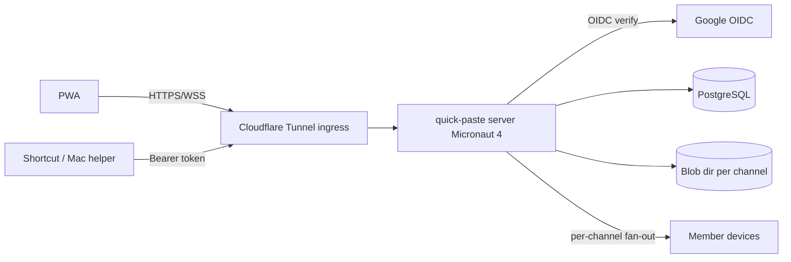

# quick-paste — Functional Specification

**Version:** 3.0 (draft)
**Owner:** Vaibhav
**Status:** For build (Claude Code)
**Last updated:** 2026-07-06

> **What changed in v2 (vs v1.0).** quick-paste moves from a single-owner tool to
> a **multi-user, channel-based** tool. Each user signs in with **Google** and
> gets a private channel; users can create and be invited to **shared** channels
> (e.g. `family`, `work`). Authentication is now handled **in the application**
> via Google OIDC — **Cloudflare provides ingress only** (the Tunnel exposes the
> public HTTPS FQDN); Cloudflare Access is no longer used. Data is isolated
> **per channel**. See §14 for the full list of resolved decisions.

> **What changed in v3.** quick-paste gains a second, permanent space alongside
> the existing ephemeral **Stream**: a per-user **Library**. A **Keep** action
> promotes any clip into the Library before its TTL takes it; kept items never
> expire, are editable, searchable, and tagged. Saves render as **content-aware
> cards** (product / article / video / quote / link / note / image / file) built
> from a **client-first extraction ladder** (browser extension → server
> `/api/resolve` → favicon floor), and are optionally enriched by **tiered AI**
> (on-device Gemini Nano first, server-side Claude/Ollama opt-in second). The
> Library is **plaintext-on-server** and **personal-only** in v3. See §5.13 and
> §8.7–§8.9 for the model/API, and the new resolved decisions D-11–D-14 (§14).

---

## 1. Overview

quick-paste is a self-hosted tool for moving **clipboard text** and **files**
between a small, trusted set of people and their devices (Macs, Android phones,
iPads/iPhones) with minimal friction. It exposes a single HTTPS endpoint on the
owner's domain, reachable from anywhere through an existing Cloudflare Tunnel.

The mental model is a set of **shared, ephemeral clipboard streams** called
**channels**. Every member of a channel can push an item (text or file) and pull
the latest; the server pushes new items to all connected member devices in real
time. Items expire automatically. Each user always has one **private** channel;
**shared** channels are how two or more users exchange content.

### 1.1 Goals

- Move plain-text clipboard content between any two of a user's devices in a couple of seconds.
- Move files (documents, images) between devices without email/AirDrop/USB workarounds.
- Let a small trusted group share a channel so members can exchange clips and files.
- Real-time delivery: a new item appears on other member devices without manual refresh.
- Zero app-store friction — installable as a web app, with native "quick" entry points only where they add real value.
- Self-hosted and small-scale multi-tenant: data lives on the owner's box; nothing on third-party servers beyond Cloudflare's transit layer and Google for sign-in.

### 1.2 Non-goals (v1)

- Large-scale / public SaaS. Target is a small trusted group (§5, capacity in §6).
- Rich-clipboard fidelity (RTF/HTML/styled text). Text is plain UTF-8; anything else moves as a file.
- End-to-end encryption. Deferred to v2 (§15); the ciphertext **envelope** contract is reserved now (§8.1, §9.9) so adding it later is not a breaking change. The reserved envelope is a **Stream-only** concept; a **client-side-encrypted Library** is an explicit non-goal (§9.10) — it would require client-side search and is a different product mode.
- Universal ephemerality. In v3 the **Stream** is ephemeral (TTLs, the fading lifeline); the **Library** is **permanent by design** (§5.13). Kept items and their blobs do not expire — permanence is the point of the Library, and the visual contrast with the fading Stream is deliberate.
- Native iOS/Android apps. The mobile "quick" experience is a PWA plus Shortcuts / Web Share Target.
- Background clipboard capture on iOS/iPadOS. Not possible on the platform; foreground/manual only.
- Collaborative editing, versioning, or conflict resolution beyond last-write-wins.
- Per-item ACLs inside a channel. Authorization granularity is the **channel**; membership is all-or-nothing.

### 1.3 Success criteria & SLOs

- **Latency.** Text pushed on one device is retrievable (and, where supported, auto-delivered) on another member device in **≤ 2 s** (p95) under normal network conditions.
- **File transfer.** A file up to the configured size limit transfers reliably end to end.
- **No loss.** The system recovers cleanly from a WebSocket disconnect (gap-free catch-up on reconnect, no lost items within the TTL window).
- **Isolation.** A user never sees, receives events for, or can access content in a channel they are not a member of. (Hard requirement; see §9.5.)
- **Availability.** Best-effort for a self-hosted single instance; target 99% monthly, `/health` used for restart automation.
- All target devices can both send and receive across the channels the user belongs to.

---

## 2. Personas, users & devices

- **Users.** A small set of people, each authenticating with a Google account on the email allowlist / invited by an admin (§9). One user is the **admin** (bootstrapped from `QP_ALLOWED_EMAILS`).
- **Devices.** Each user has multiple devices; each device is both sender and receiver.

| Device | Send path | Receive path | Background capture |
|---|---|---|---|
| Mac | Menu-bar helper (auto) + PWA | Menu-bar helper writes to clipboard + PWA | Yes (helper) |
| Android phone | PWA + system Share sheet (Web Share Target) | PWA + web push | No |
| iPad / iPhone | PWA + Shortcut (Share sheet / Home screen) | PWA + Shortcut ("get latest") | No |
| Desktop browser | PWA | PWA + web push | No |

Device identity is a human-readable **label** (`mac`, `pixel`, `ipad`) stored
client-side and sent as `origin` on every push (§5.8). The authenticated **user**
(not the device) is the security principal.

---

## 3. Channels model

- **Private channel.** Auto-created for every user on first login. Only that user is a member. It is the default target for pushes and behaves like the v1 personal stream.
- **Shared channel.** Created by a user (its `owner`); other users are added by invitation (§5.2). All members can read and write; the owner can manage membership and delete the channel.
- **Membership = authorization.** A clip/file belongs to exactly one channel. A user may act on a clip/file only if they are a member of its channel.
- **Isolation.** Dedup, blob storage, TTL sweep, and real-time fan-out are all scoped **per channel** (§8.1, §9.5). Identical content in two channels is stored and deduped independently — never shared across channels.
- **Selection.** The client always operates "in" a currently selected channel; pushes and history are scoped to it. The WebSocket subscribes to **all** channels the user belongs to (§8.5).

---

## 4. Key use cases

- **UC-1 — Text, Mac → iPad (same user, private channel).** User copies text on the Mac; the helper captures and pushes it; the user's iPad PWA receives the event and offers one-tap copy, or a "get latest" Shortcut pulls it to the iPad clipboard.
- **UC-2 — Text, iPad → Mac (same user).** User runs the "send to quick-paste" Shortcut with clipboard content; the Mac helper receives it and places it on the Mac clipboard automatically.
- **UC-3 — File, Android → Mac (same user).** User shares a file to quick-paste from any Android app via the Share sheet; it uploads; the Mac PWA shows it with a download action.
- **UC-4 — File, Mac → iPad (same user).** User drops a file onto the Mac PWA; the iPad PWA receives the event and downloads it.
- **UC-5 — Share across users (shared channel).** User A pushes a link into the `family` channel; users B and C (members) receive it live on their devices.
- **UC-6 — Manage a channel.** A user creates a `work` channel, invites a colleague by email, and later removes them; membership changes propagate.
- **UC-7 — Re-use history.** User opens the PWA, switches channels, scrolls recent items, and re-copies text or re-downloads a file from an earlier entry.
- **UC-8 — Live notification.** A member device with the PWA open (or web push enabled) is notified the moment a new item arrives in one of its channels.
- **UC-9 — Clear.** A member deletes a single item or clears a channel; the change propagates to that channel's members.
- **UC-10 — Automation auth.** A user mints an API token in the PWA and configures an iOS Shortcut / the Mac helper to authenticate with it.

---

## 5. Functional requirements

### 5.1 Authentication & identity

- **FR-1** Interactive users authenticate via **Google OIDC** (Authorization Code + PKCE). The server verifies the ID token and establishes an application session (§9.2, §9.4).
- **FR-1a** For deployments **without a public FQDN** (home-LAN use), `QP_AUTH_MODE=local` replaces Google sign-in with a single-owner password login (`QP_LOCAL_PASSWORD`, login rate-limited, constant-time compare). One `owner@local` admin account is provisioned on first login; multi-user features remain available but no other identity can sign in. Google mode is the default and is required for multi-user deployments.
- **FR-2** Access is gated: an email may sign in only if it is in the seed allowlist (`QP_ALLOWED_EMAILS`) **or** has a pending/active membership from an invitation. Invitations that grant **first-time access** (an email with no registered account) can only be created by an **admin**; non-admin channel owners can invite only already-registered users (FR-8). Unlisted, uninvited emails are rejected after Google login with a clear "not authorized" response.
- **FR-3** The first user whose email is in `QP_ALLOWED_EMAILS` is provisioned as **admin** on first login.
- **FR-4** Automated clients authenticate with a per-user **API token** (bearer). Tokens are minted in the PWA, shown once, and map to the creating user (§9.3).
- **FR-5** `GET /api/auth/me` returns the current user, their channels, and admin flag.

### 5.2 Channels & membership

- **FR-6** On first login, the server creates the user's **private** channel.
- **FR-7** A user can create a **shared** channel (becomes its `owner`).
- **FR-8** A channel owner can invite users by email, remove members, and cancel pending invites; a member can leave a shared channel. The private channel cannot be left, shared, or deleted. Inviting an email that has no registered account yet is **admin-only** (FR-2).
- **FR-9** An admin inviting an email not yet registered creates a **pending** membership that activates on that user's first successful login. Pending invites can be canceled via the membership endpoint (§8.2).
- **FR-10** A channel owner can delete a shared **or external** channel; this cascades to its clips, files, blobs, and (for external) sink config (§5.7, §5.14).
- **FR-11** Shared channel membership is capped at `QP_CHANNEL_MAX_MEMBERS`.

### 5.14 External sink channels (provider extension point)

An **external** channel is a personal, one-way **outbound sink**: text clips the
owner pushes are stored locally (same TTL/dedup as other channels) **and**
forwarded asynchronously to a configured external system. External channels are
distinct from the in-app Library (Keep / §5.13): they do not auto-Keep, and
there is **no inbound sync** from the remote system.

**Status.** This section specifies the contract. The public tree documents how to
add a provider (`docs/external-providers.md`); **no concrete provider is shipped
in the public repo.** Personal adapters (private knowledge stores, etc.) stay
out of source control under `local/` or an unpushed branch — see that doc.

Providers are **compile-time** registrations (NFR-11 — no plugin runtime). Each
provider supplies: create/validate config, map a text clip → outbound payload,
and HTTP (or other) delivery with idempotency.

- **FR-61** A user can create an **external** channel (`type=external`) with a
  display name, `provider` id, and provider-specific config (at minimum a
  **https** `baseUrl` on a public host — private/loopback/link-local targets
  rejected as SSRF — and a bearer `token`). The channel is owner-only (no
  invites, no leave). The token is stored encrypted at rest (AES-GCM; key from
  `QP_SESSION_SECRET`); APIs return only a `tokenPrefix`, never the secret.
- **FR-62** Text clips in an external channel are stored locally **and**
  enqueued for delivery. The clip ULID is the delivery **idempotency key** so
  retries never duplicate at the remote. Optional provider-specific kind/tags
  may be supplied on create; semantics are defined by the provider.
- **FR-63** File uploads and `type=file` clips are **rejected** on external
  channels (422) unless a future provider explicitly documents file support.
- **FR-64** Delivery is **asynchronous**: clip create returns immediately with
  `delivery.status=pending` and never waits on outbound HTTP. A worker delivers
  (no redirects), honors `429` + `Retry-After` when present, retries with
  backoff up to `QP_SINK_MAX_ATTEMPTS`, and updates status to
  `sent` / `deduped` / `failed`. Auth and validation failures are **terminal**
  (not re-polled). Status is exposed on `ClipDto.delivery` and re-broadcast via
  `clip.created` (client upserts by id) when it changes.
- **FR-65** The owner can rotate sink credentials / base URL / provider options
  via `PATCH /api/channels/{id}/sink`, and delete the external channel (FR-10).

### 5.3 Clipboard text sync

- **FR-12** A member can push a text item to a channel (`type=text`, UTF-8 body, `origin` device label). The server records `origin_user_id` and `channel_id`.
- **FR-13** The server stores the item, assigns a ULID and timestamp, and broadcasts a creation event to all connected member devices of that channel.
- **FR-14** A member can retrieve the latest item and a window of recent items **for a channel**.
- **FR-15** A member can copy a received text item to the local clipboard via a single user action (required on iOS/iPadOS).
- **FR-16** The Mac helper captures local clipboard changes automatically and pushes them to the selected channel, subject to loop-prevention (§5.10).
- **FR-17** Text items above `QP_MAX_TEXT_KB` (default 256 KB) are rejected with guidance to send as a file.
- **FR-18** A push matching the dedup rule of FR-42 — same `(channel_id, origin_user_id, origin, content_hash)` within `QP_DEDUP_WINDOW_SEC` — is treated as a no-op and not re-broadcast.

### 5.4 File transfer

- **FR-19** A member can upload a file (scoped to a channel) and receive a `fileId`, then create a clip of `type=file` referencing it. Upload and clip-creation are two steps so large uploads can be chunked/resumable.
- **FR-20** Files at or below `QP_SIMPLE_UPLOAD_MB` (default 20 MB) may use a single multipart upload. Larger files use the resumable (tus) flow (§8.6).
- **FR-21** A member can download a file by id; the server streams bytes with correct `Content-Type` and `Content-Disposition` (original filename preserved, sanitized per §9.7).
- **FR-22** File metadata (name, size, MIME type, checksum) is available without downloading the body.
- **FR-23** For image MIME types, the server may generate a thumbnail for preview (`QP_THUMBNAILS_ENABLED`; disabled when E2E is on in v2).
- **FR-24** Uploads compute and store a SHA-256 checksum. Dedup is **per channel** only (§9.5).
- **FR-25** Upload finalize is rejected if it would exceed the user's storage quota (`QP_USER_QUOTA_MB`, §5.11).

### 5.5 Real-time sync

- **FR-26** Each device maintains a single authenticated WebSocket connection for live events across all of the user's channels.
- **FR-27** On connect, the client sends a `hello` frame listing, per channel, the last item id it has seen (`afterId`). The server first replays items created after `afterId` (catch-up, in ULID order), then streams live events. Catch-up uses the **ULID cursor**, not a timestamp, to guarantee gap-free delivery (§8.5).
- **FR-28** The server emits `clip.created`, `clip.deleted`, `clips.cleared`, and membership events (`channel.joined`, `channel.left`, `channel.deleted`), each carrying `channelId`.
- **FR-29** The connection uses periodic ping/pong heartbeats; clients reconnect with exponential backoff and re-run catch-up on reconnect.

### 5.6 History

- **FR-30** A member can list recent items in a channel (newest-first, `limit`, cursor `afterId`/`beforeId`, optional `type` filter).
- **FR-31** A member can re-copy text or re-download a file from any listed item.

### 5.7 Deletion & lifecycle

- **FR-32** A member can delete a single item by id (must be a member of its channel).
- **FR-33** A member can clear an entire channel's stream.
- **FR-34** Deleting a file clip removes the underlying blob if no other clip **in the same channel** references it.
- **FR-35** Text clips expire after `QP_CLIP_TTL_HOURS` (default 24); file clips and blobs after `QP_FILE_TTL_HOURS` (default 72). A scheduled sweep removes expired rows and orphaned blobs, per channel.
- **FR-36** Deleting a channel or a user cascades to owned clips, files, blobs, tokens, sessions, and memberships (§5.12).

### 5.8 Device identity

- **FR-37** Each device has a human-readable label stored client-side, sent as `origin` on every push, so the UI shows where an item came from and who sent it (`origin_user_id`). No server-side device registry is required.

### 5.9 Notifications

- **FR-38** Where supported (Android, desktop browsers, installed iOS PWA on 16.4+), the PWA may register for web push (VAPID) and raise a notification on `clip.created` for the user's channels. Subscriptions are stored per user/device in `push_subscriptions` (§8.1) via the push endpoints (§8.2); keys come from `QP_VAPID_*` (§11) — push is disabled if they are unset. Delivery skips only the **originating user's** matching device (labels are not unique across members); payloads carry metadata only, never clip content (NFR-6).
- **FR-39** The Mac menu-bar helper shows the latest item in its menu and offers a one-click "copy to clipboard".

### 5.10 Loop prevention & idempotency

- **FR-40** The Mac helper must not re-push clipboard content it just wrote (track the hash of the last value written locally and ignore it on the next capture).
- **FR-41** Clients may include an idempotency key on push. The server dedups repeated pushes of the same key within a retention window and **replays the original response** (not a bare no-op).
- **FR-42** The server dedups by `(channel_id, origin_user_id, origin, content_hash)` within `QP_DEDUP_WINDOW_SEC` to break echo loops. The key includes the **user**: device labels are not unique across members, and one member's clip must never suppress another member's identical push.

### 5.11 Quotas & rate limiting

- **FR-43** Each user has a storage quota (`QP_USER_QUOTA_MB`) summed across their owned blobs; enforced **before** finalizing simple and resumable uploads.
- **FR-44** Requests are rate-limited per session and per API token; the login endpoint has a stricter limit (`QP_LOGIN_RATE_LIMIT_PER_MIN`). Exceeding a limit returns `429` with `Retry-After`.
- **FR-45** WebSocket connections are capped per user (`QP_MAX_WS_CONN_PER_USER`).

### 5.12 Account lifecycle

- **FR-46** A user can delete their account; this cascades (FR-36) and revokes all sessions and tokens.
- **FR-47** A user can export their data (channel metadata + clip/file metadata + blobs; **and, in v3, Library items + tags + `item_files` and their pinned blobs**, §5.13) via an async export job: the request returns a `jobId`, status is pollable, and the finished archive is downloadable until it expires (`QP_EXPORT_TTL_HOURS`); see §8.2. Archives live under `QP_STORAGE_DIR/exports/` and are GC'd by the sweep.
- **FR-48** A user can revoke a single API token and "sign out everywhere" (revoke all sessions).
- **FR-49** An admin can list users and disable/remove a user via the admin endpoints (§8.2); disable revokes sessions/tokens, remove cascades per FR-36.

### 5.13 Library (permanent per-user space)

The **Library** is a second space alongside the ephemeral Stream: a permanent,
**per-user** collection of **items**. Nothing lands there unless deliberately
**Kept**. Items are editable, searchable, and tagged, and never expire. The
Library is `user_id`-scoped (personal-only in v3; §9.5, D-11) and
**plaintext-on-server** (§9.10, D-12). Data model in §8.7, API in §8.8, cards
and extraction in §8.9.

- **FR-50** A member can **Keep** a clip — copy it into their Library as an
  **item** before the clip's TTL removes it. Keep is available from PWA Stream
  rows/hero, the browser extension, and the API (§8.8). Keeping a **file** clip
  copies the **reference** to the underlying blob (not the bytes) into the item;
  that blob is thereby **pinned** and never expires (FR-34, §8.7, §12.6).
- **FR-51** An item has a `kind` (`note` \| `quote` \| `link` \| `article` \|
  `product` \| `video` \| `image` \| `file`) that selects its card renderer
  (§8.9). Kind is derived at save time by the extraction ladder and may be
  refined by AI enrichment or user edit.
- **FR-52** A user can **create** an item directly (a note authored in the PWA,
  or a structured capture payload from the extension/`/api/resolve`), **list**,
  **search**, **fetch**, **edit**, and **delete** their own items. Item editing
  is **last-write-wins** (consistent with the non-goal of conflict resolution).
- **FR-53** Search: full-text over `title`/`body` (PostgreSQL `tsvector` +
  `websearch_to_tsquery`, ranked by `ts_rank`) combined with filters on `kind`,
  `tag`, `pinned`, and `archived`. Results page via the ULID cursor (§8.4).
  Semantic (embedding) search is an L3 addition (FR-59).
- **FR-54** Tags are user-scoped labels. A user can create, apply, remove, and
  delete tags on their items (§8.7). AI-suggested tags (`meta.ai.tags`) are
  **suggestions only** until the user **accepts** them; accepting materializes
  real `tags` / `item_tags` rows.
- **FR-55** An item can be **pinned** (surfaced first), **archived** (hidden
  from the default view, retained), or moved to **trash** (soft delete via
  `deleted_at`). Trashed items are hard-purged by the sweep after
  `QP_TRASH_TTL_DAYS` (§12.6); a user may also hard-purge an item immediately
  (§8.8).
- **FR-56** Saves render as **content-aware cards** built by the extraction
  ladder (§8.9): (1) client-first, in-DOM extraction in the browser extension
  (selection, canonical URL, JSON-LD, OG/Twitter meta, best image); (2) a
  server fallback `POST /api/resolve` for bare URLs from PWA/Shortcuts; (3) a
  floor of favicon + domain + title. Every save must render as something
  respectable.
- **FR-57** Card images (OG / product / cover images) are **downloaded into the
  blob store at save time** (size-capped by `QP_RESOLVE_MAX_KB`) and referenced
  via `item_files` with `role=cover` — never hotlinked. Favicons are cached the
  same way (`role=favicon`).
- **FR-58** **Canonical-URL dedup.** Saving a page already in the Library (same
  `canonical_url` for that user) **updates** the existing item and bumps
  `updated_at` rather than creating a duplicate.
- **FR-59** **Tiered AI enrichment** (optional; §8.9). Tier 1: on-device
  **Gemini Nano** in the extension — default-on where the hardware/browser
  supports it, runs entirely on-device (no content leaves the box), used only
  to normalize/enrich after deterministic extraction (title cleanup, kind
  classification for the long tail, 3–6 suggested tags, one-line summary).
  Tier 2: **server-side enrichment** (Claude API or local Ollama), **opt-in**
  via `QP_AI_ENABLED` (off by default; enabling sends content off-box, stated
  plainly in docs). Both tiers write results to `meta.ai` as **machine-suggested**
  (provider + model recorded) and never block the card. Enrichment is delivered
  post-save via `PATCH /api/items/{id}/enrichment` (§8.8).
- **FR-60** **Semantic search (L3).** At save time the server may compute an
  embedding into a pgvector `vector` column (HNSW index); search then runs a
  hybrid `tsvector` + vector query. Nano exposes no embedding API, so this tier
  is server-side regardless of Tier-1 availability (§8.7, §8.9).

---

## 6. Non-functional requirements

- **NFR-1 — Latency.** Text end-to-end ≤ 2 s (p95); WebSocket event fan-out ≤ 250 ms server-side.
- **NFR-2 — File size.** Support files up to `QP_MAX_FILE_MB` (default 512 MB) via the resumable path.
- **NFR-3 — Reliability.** No item loss across a WebSocket disconnect; ULID-cursor catch-up guarantees eventual delivery to reconnecting devices within the TTL window.
- **NFR-4 — Security.** All transit over HTTPS/WSS via Cloudflare; all requests authenticated and authorized at the origin (§9); secrets from environment/secret store, never committed.
- **NFR-5 — Isolation.** Strict per-channel isolation; no cross-channel or cross-user data access or event leakage (§9.5).
- **NFR-6 — Privacy.** Self-hosted; no third-party analytics/telemetry. Google is used only for sign-in identity (no Google API access/refresh tokens stored). Data is ephemeral by default.
- **NFR-7 — Capacity (tiny scale).** Target < ~20 users and < ~100 concurrent device connections on a **single instance** with in-process WebSocket fan-out. No message broker (see NFR-9 for the scale-out trigger).
- **NFR-8 — Portability.** Runs as a single fat JAR plus PostgreSQL; `docker-compose.yml` brings up the whole stack. Blob storage is a local directory (pluggable to S3/MinIO later).
- **NFR-9 — Scale-out trigger.** In-process fan-out is a single point of failure and a scaling ceiling. If usage exceeds NFR-7 or multi-instance is required, revisit with sticky sessions + Redis pub/sub for WS fan-out and a shared/object blob store. This is explicitly out of scope for v1.
- **NFR-10 — Observability.** Structured JSON logging, `/health` liveness + readiness, and aggregate metrics (item counts, upload sizes, active WS connections). Metrics are **not** labeled by user/channel id (cardinality); per-user detail lives in logs.
- **NFR-11 — Simplicity.** Single service, no broker, in-process fan-out. Do not introduce plugin systems or a broker in v1.
- **NFR-12 — Backups (Library durability).** The Library is permanent data the user cannot afford to lose, so the v1 "TTL data needs no PITR" stance no longer covers everything. Operators must run a scheduled backup of the PostgreSQL database (`pg_dump`) together with a copy of the blob directory (item-pinned blobs included), with documented retention (§12.5). Stream-only data remains best-effort.

---

## 7. System architecture

**Components:**

- **Clients** — a PWA (all devices), a Mac menu-bar helper (Phase 3), and iOS Shortcuts (Phase 2).
- **Cloudflare** — Tunnel only: public HTTPS ingress, no open ports. **No Cloudflare Access.** (An optional Access outer layer can be re-enabled via `QP_CF_ACCESS_ENABLED` as defense-in-depth, off by default.)
- **quick-paste server** — Micronaut 4 (Java 17): REST + WebSocket; Google OIDC login; session + token auth; channel authorization; TTL sweep; blob I/O.
- **Storage** — PostgreSQL (pgvector-enabled image, for the v3 Library's semantic search) for users/channels/membership/clip/file metadata and text bodies; local filesystem for file blobs, partitioned by channel.
- **Google** — OIDC identity provider for interactive sign-in.



**Recommended / locked stack:**

- Server: Java 17, Micronaut 4, PostgreSQL + pgvector, Flyway (migrations), Quartz (TTL sweep), Micronaut WebSocket, `nimbus-jose-jwt` (Google ID-token verification). **Build: Gradle** (fat JAR via shadow).
- PWA: **Vite + React + TypeScript**, static build, PWA manifest + service worker (`vite-plugin-pwa` / Workbox).
- Mac helper: **Tauri** (Rust + web UI, small signed binary).
- Large uploads: **tus** resumable protocol.
- Deployment: single fat JAR behind the existing Cloudflare Tunnel; PWA served as static resources from the Micronaut app (or a separate Cloudflare Pages project against the same API host).

---

## 8. Data model & API

### 8.1 Tables

> Types are PostgreSQL. `TIMESTAMPTZ(3)` = millisecond UTC instants;
> `ENUM`-style columns are stored as `VARCHAR` with a `CHECK` constraint;
> `CHAR(26)` = ULID; `BYTEA` = the reserved E2E IV. Enum value sets are
> shown in parentheses.

**`users`**

| Column | Type | Notes |
|---|---|---|
| `id` | CHAR(26) | ULID, PK |
| `email` | VARCHAR(255) | unique; from Google |
| `google_sub` | VARCHAR(255) | unique; Google subject id |
| `display_name` | VARCHAR(255) | from Google profile |
| `is_admin` | BOOLEAN | seeded from `QP_ALLOWED_EMAILS` |
| `status` | VARCHAR (`active`,`disabled`) | admin can disable |
| `created_at` | TIMESTAMPTZ(3) | |
| `last_login_at` | TIMESTAMPTZ(3) NULL | |

**`channels`**

| Column | Type | Notes |
|---|---|---|
| `id` | CHAR(26) | ULID, PK |
| `name` | VARCHAR(64) | display name |
| `type` | VARCHAR (`private`,`shared`,`external`) | |
| `created_by` | CHAR(26) | FK → `users.id` |
| `created_at` | TIMESTAMPTZ(3) | |

**`channel_sinks`** — outbound integration config for `type=external` channels.

| Column | Type | Notes |
|---|---|---|
| `channel_id` | CHAR(26) | PK, FK → `channels.id` ON DELETE CASCADE |
| `provider` | VARCHAR | Compile-time provider id (see `docs/external-providers.md`) |
| `base_url` | VARCHAR(512) | https origin (or provider-defined base); SSRF-checked |
| `token_ciphertext` | TEXT | AES-GCM blob (key from `QP_SESSION_SECRET`); never logged/returned |
| `token_prefix` | VARCHAR(16) | display hint (e.g. first 12 chars) |
| `default_tags` | TEXT NULL | JSON string array, ≤ 32 tags (provider-optional) |
| `created_at` / `updated_at` | TIMESTAMPTZ(3) | |

**`clip_deliveries`** — per-clip outbound delivery ledger for external sinks.

| Column | Type | Notes |
|---|---|---|
| `clip_id` | CHAR(26) | PK, FK → `clips.id` ON DELETE CASCADE |
| `channel_id` | CHAR(26) | FK → `channels.id` ON DELETE CASCADE; indexed |
| `status` | VARCHAR (`pending`,`sent`,`deduped`,`failed`) | |
| `kind` | VARCHAR NULL | Provider-specific kind label when applicable |
| `external_item_id` | VARCHAR(64) NULL | Remote id when the provider returns one |
| `attempts` | INT | |
| `next_attempt_at` | TIMESTAMPTZ(3) | |
| `last_error` | VARCHAR(512) NULL | metadata only — never payloads/tokens |
| `updated_at` | TIMESTAMPTZ(3) | |

**`channel_members`**

| Column | Type | Notes |
|---|---|---|
| `id` | CHAR(26) | ULID, PK; the `memberId` used by the membership endpoints (§8.2) |
| `channel_id` | CHAR(26) | FK → `channels.id` |
| `user_id` | CHAR(26) NULL | FK → `users.id`; NULL while invitation pending |
| `invited_email` | VARCHAR(255) NULL | set for pending invites |
| `role` | VARCHAR (`owner`,`member`) | |
| `status` | VARCHAR (`pending`,`active`) | |
| `joined_at` | TIMESTAMPTZ(3) NULL | |

Surrogate ULID PK (a composite PK can't hold the NULLable `user_id`). Unique
`(channel_id, user_id)` for active rows; unique `(channel_id, invited_email)`
for pending ones.

**`api_tokens`**

| Column | Type | Notes |
|---|---|---|
| `id` | CHAR(26) | ULID, PK |
| `user_id` | CHAR(26) | FK → `users.id` |
| `name` | VARCHAR(64) | user label |
| `token_hash` | CHAR(64) | SHA-256 of the secret |
| `prefix` | VARCHAR(12) | shown for identification |
| `scope` | VARCHAR (`read`,`write`) | default `write` |
| `created_at` | TIMESTAMPTZ(3) | |
| `last_used_at` | TIMESTAMPTZ(3) NULL | |
| `expires_at` | TIMESTAMPTZ(3) NULL | NULL = no expiry |
| `revoked_at` | TIMESTAMPTZ(3) NULL | |

**`sessions`**

| Column | Type | Notes |
|---|---|---|
| `id` | CHAR(26) | ULID, PK (opaque cookie value is HMAC of this) |
| `user_id` | CHAR(26) | FK → `users.id` |
| `created_at` | TIMESTAMPTZ(3) | |
| `expires_at` | TIMESTAMPTZ(3) | |
| `user_agent` | VARCHAR(255) | for the sessions list |
| `revoked_at` | TIMESTAMPTZ(3) NULL | |

**`push_subscriptions`**

| Column | Type | Notes |
|---|---|---|
| `id` | CHAR(26) | ULID, PK |
| `user_id` | CHAR(26) | FK → `users.id` |
| `endpoint` | VARCHAR(512) | push service URL; unique |
| `p256dh` | VARCHAR(255) | client public key |
| `auth` | VARCHAR(255) | client auth secret |
| `device` | VARCHAR(64) | device label (`origin`) |
| `created_at` | TIMESTAMPTZ(3) | |

**`export_jobs`**

| Column | Type | Notes |
|---|---|---|
| `id` | CHAR(26) | ULID, PK (the `jobId`) |
| `user_id` | CHAR(26) | FK → `users.id` |
| `status` | VARCHAR (`pending`,`running`,`done`,`failed`) | |
| `storage_path` | VARCHAR(512) NULL | archive under `QP_STORAGE_DIR/exports/` when done |
| `created_at` | TIMESTAMPTZ(3) | |
| `expires_at` | TIMESTAMPTZ(3) | archive GC'd by sweep (`QP_EXPORT_TTL_HOURS`) |

**`clips`**

| Column | Type | Notes |
|---|---|---|
| `id` | CHAR(26) | ULID, PK (also the catch-up cursor) |
| `channel_id` | CHAR(26) | FK → `channels.id` |
| `origin_user_id` | CHAR(26) | FK → `users.id` |
| `origin_device` | VARCHAR(64) | e.g. `mac`, `ipad` |
| `type` | VARCHAR (`text`,`file`) | |
| `text` | TEXT NULL | populated when `type=text` (plaintext in v1) |
| `file_id` | CHAR(26) NULL | FK → `files.id` when `type=file` |
| `content_hash` | CHAR(64) | SHA-256 of text or file, for dedup |
| `encrypted` | BOOLEAN | **reserved for v2 E2E**, always `false` in v1 |
| `enc_algo` | VARCHAR(32) NULL | **reserved** (e.g. `AES-256-GCM`) |
| `iv` | BYTEA NULL | **reserved** (nonce/IV) |
| `created_at` | TIMESTAMPTZ(3) | server-assigned |
| `expires_at` | TIMESTAMPTZ(3) | for the sweep |

Indexes: `(channel_id, created_at)`, `(channel_id, id)`, `(channel_id, expires_at)`, `(channel_id, origin_device, content_hash)`.

**`files`**

| Column | Type | Notes |
|---|---|---|
| `id` | CHAR(26) | ULID, PK |
| `channel_id` | CHAR(26) | FK → `channels.id` (isolation + GC scope) |
| `created_by` | CHAR(26) | FK → `users.id`; uploader — the per-user quota basis (FR-43) |
| `name` | VARCHAR(255) | original filename |
| `mime` | VARCHAR(128) | |
| `size` | BIGINT | bytes |
| `storage_path` | VARCHAR(512) | path under `QP_STORAGE_DIR/{channelId}/` |
| `checksum` | CHAR(64) | SHA-256 |
| `created_at` | TIMESTAMPTZ(3) | |
| `expires_at` | TIMESTAMPTZ(3) | |

> **E2E envelope (reserved).** When E2E is enabled in v2, `text`/blob bytes hold
> ciphertext, `encrypted=true`, `enc_algo` names the AEAD, and `iv` holds the
> nonce. The symmetric key is a **per-channel key** distributed to members
> client-side (§9.9). Server-side thumbnails, push previews, and content dedup
> are disabled for encrypted channels.

### 8.2 REST endpoints

All endpoints except `/health` and the auth-initiation endpoints require a valid
session cookie **or** API token (§9). All requests are authorized against
channel membership (§9.5). All responses are JSON unless noted.

**Auth & account**

| Method | Path | Purpose | Response |
|---|---|---|---|
| GET | `/api/auth/mode` | Sign-in capability discovery (unauthenticated) | `200 {mode}` |
| GET | `/api/auth/login` | Begin Google OIDC (sets `state`+PKCE, redirects); `422` in local mode | `302` |
| POST | `/api/auth/login-local` | Password sign-in when `QP_AUTH_MODE=local` (FR-1a) | `204` + cookies |
| GET | `/api/auth/callback` | OIDC redirect handler; verifies + creates session | `302` to app |
| POST | `/api/auth/logout` | Revoke current session | `204` |
| GET | `/api/auth/me` | Current user + channels + admin flag | `200 {user, channels}` |
| POST | `/api/account/logout-all` | Revoke all sessions | `204` |
| DELETE | `/api/account` | Delete account (cascade) | `204` |
| POST | `/api/account/export` | Request a data export archive | `202 {jobId}` |
| GET | `/api/account/export/{jobId}` | Export job status | `200 {jobId, status, expiresAt?}` |
| GET | `/api/account/export/{jobId}/download` | Download finished archive | `200` stream |

**Push subscriptions**

| Method | Path | Purpose | Response |
|---|---|---|---|
| POST | `/api/push/subscriptions` | Register a web-push subscription `{endpoint, keys, device}`; `endpoint` must be an `https://` URL (SSRF guard; loopback `http://` allowed for dev) | `201 {id}` |
| DELETE | `/api/push/subscriptions/{id}` | Remove a subscription | `204` |

**Admin (admin only)**

| Method | Path | Purpose | Response |
|---|---|---|---|
| GET | `/api/admin/users` | List users (status, admin flag, storage use) | `200 {items}` |
| PATCH | `/api/admin/users/{id}` | Set `{status}` (`active`/`disabled`; disable revokes sessions + tokens) | `200 {user}` |
| DELETE | `/api/admin/users/{id}` | Remove user (cascade per FR-36) | `204` |

**API tokens**

| Method | Path | Purpose | Response |
|---|---|---|---|
| POST | `/api/tokens` | Mint a token `{name, scope?}` (secret returned once) | `201 {id, token, prefix}` |
| GET | `/api/tokens` | List tokens (metadata only) | `200 {items}` |
| DELETE | `/api/tokens/{id}` | Revoke a token | `204` |

**Channels & membership**

| Method | Path | Purpose | Response |
|---|---|---|---|
| GET | `/api/channels` | List channels the user belongs to | `200 {items}` |
| POST | `/api/channels` | Create a shared channel `{name}` **or** external sink `{name, type:"external", provider, baseUrl, token, defaultTags?}` (FR-61; provider must be registered) | `201 {channel}` |
| DELETE | `/api/channels/{id}` | Delete a shared or external channel (owner only, cascade) | `204` |
| PATCH | `/api/channels/{id}/sink` | Rotate sink config (owner; external only) `{token?, baseUrl?, defaultTags?}` | `200 {channel}` |
| GET | `/api/channels/{id}/members` | List members (member only) | `200 {items}` |
| POST | `/api/channels/{id}/members` | Invite by email (owner only; new emails admin-only, FR-2); rejected for private/external | `201 {member}` |
| DELETE | `/api/channels/{id}/members/{memberId}` | Remove member / leave / cancel pending invite | `204` |

**Clips & files (scoped to a channel)**

| Method | Path | Purpose | Response |
|---|---|---|---|
| POST | `/api/channels/{cid}/clips` | Create clip `{type, text?, fileId?, origin, idempotencyKey?, sinkKind?}`; external channels reject `type=file` and enqueue sink delivery (FR-61–64) | `201 {clip}` (`delivery?` when external) |
| GET | `/api/channels/{cid}/clips/latest` | Latest clip | `200 {clip}` or `204` |
| GET | `/api/channels/{cid}/clips` | List (`afterId?`, `beforeId?`, `limit?`=50, `type?`) | `200 {items, nextCursor?}` |
| DELETE | `/api/channels/{cid}/clips/{id}` | Delete one clip | `204` |
| DELETE | `/api/channels/{cid}/clips` | Clear channel | `204` |
| POST | `/api/channels/{cid}/files` | Simple multipart upload (≤ `QP_SIMPLE_UPLOAD_MB`) | `201 {fileId, name, size, mime}` |
| GET | `/api/channels/{cid}/files/{id}` | Download bytes + `Content-Disposition` | `200` stream |
| GET | `/api/channels/{cid}/files/{id}/meta` | File metadata | `200 {id, name, size, mime, checksum}` |
| GET | `/api/channels/{cid}/files/{id}/thumbnail` | JPEG thumbnail for image files (FR-23) | `200` image or `404` |
| GET | `/api/config` | Client-facing limits + push capability (size caps, `pushEnabled`, VAPID public key) | `200 {…}` |
| GET | `/health` | Liveness/readiness (unauthenticated) | `200 {status, checks}` |

Resumable upload endpoints for large files are in §8.6.

### 8.3 Error schema

All non-2xx responses use a consistent envelope:

```json
{ "error": { "code": "not_authorized", "message": "You are not a member of this channel.", "details": {} } }
```

Common codes: `unauthenticated` (401), `not_authorized` (403), `not_found`
(404), `validation_failed` (422), `payload_too_large` (413),
`rate_limited` (429, with `Retry-After`), `quota_exceeded` (409),
`conflict` (409).

### 8.4 Pagination

List endpoints use **ULID cursors**: `afterId` (older→newer catch-up) and
`beforeId` (newer→older history paging), plus `limit`. Responses include
`nextCursor` when more rows exist. Cursors are stable under equal timestamps
(the ULID tie-breaks), which is why catch-up cannot lose or duplicate items.

### 8.5 WebSocket protocol — `/api/stream`

The handshake is authenticated (session cookie or `Authorization: Bearer`,
§9). The socket serves **all** channels the user belongs to.

Client → server on connect (per-channel cursors):

```json
{
  "type": "hello",
  "device": "ipad",
  "cursors": { "01J...channelA": "01J...lastClipId", "01J...channelB": null }
}
```

Server → client:

- **Catch-up.** For each channel, one `clip.created` per item with `id > cursor`,
  in ULID order, replayed in batches until drained (no truncation), then one
  `{"event": "catchup.done", "channelId", "cursor"}` marker carrying the final
  replay cursor. Clients must not trust cursor advancement from live events for
  a channel until its `catchup.done` arrives — live events can overtake the
  replay (the session is registered for fan-out before replaying) and an early
  cursor jump followed by a disconnect would skip the unreplayed items (NFR-3).
- **Reconnect reconciliation.** Catch-up replays creations only; deletions and
  clears that happened while a device was offline are reconciled by the client
  refreshing channel membership (`/api/auth/me`) and its loaded history windows
  over REST on every reconnect, before sending `hello`.
- **Live events** (each carries `channelId`):

```json
{ "event": "clip.created", "channelId": "01J...", "clip": { "id": "01J...", "type": "text", "origin": "mac", "originUserId": "01J...", "createdAt": "..." } }
{ "event": "clip.deleted", "channelId": "01J...", "id": "01J..." }
{ "event": "clips.cleared", "channelId": "01J..." }
{ "event": "channel.joined", "channel": { "id": "01J...", "name": "family", "type": "shared" } }
{ "event": "channel.left", "channelId": "01J..." }
{ "event": "channel.deleted", "channelId": "01J..." }
```

- **Fan-out is per channel.** The server maintains an in-process registry of
  `channelId → set<session>` and delivers an event only to sessions whose user is
  an active member. A membership change updates the registry live.
- **Joining a channel mid-session.** On `channel.joined` the client has no cursor
  for the new channel; it fetches recent history over REST
  (`GET /api/channels/{cid}/clips`) and uses the newest returned id as that
  channel's cursor from then on. Live events for the channel start flowing as
  soon as the registry is updated.
- **Heartbeat.** Server sends periodic `ping`; client replies `pong`. On missed
  heartbeats or socket close, the client reconnects with exponential backoff
  (1s → 2s → 5s → 15s, capped) and re-sends `hello` with updated per-channel cursors.

### 8.6 Resumable uploads (large files)

For files above `QP_SIMPLE_UPLOAD_MB`, use the **tus** protocol (mature
client/server libraries) to keep each request body under Cloudflare's proxy cap
and to survive interrupted transfers:

- `POST /api/channels/{cid}/files/uploads` — tus creation: `Upload-Length` +
  `Upload-Metadata` (`filename`, `filetype`) headers → `201` with `Location`.
  Quota is pre-checked against the declared length.
- `PATCH /api/channels/{cid}/files/uploads/{id}` — next chunk at the current
  offset (`Upload-Offset` header, `application/offset+octet-stream` body);
  a mismatched offset returns `409`.
- `HEAD /api/channels/{cid}/files/uploads/{id}` — current `Upload-Offset` /
  `Upload-Length` (for resume). All responses carry `Tus-Resumable: 1.0.0`.
- On the completing PATCH, the server re-checks quota, finalizes the blob
  (under the channel's dir), computes the checksum, and the **uploadId becomes
  the `fileId`** usable in the clip-create call.

Abandoned uploads are garbage-collected by the sweep after
`QP_UPLOAD_IDLE_GC_HOURS` (default 24) without progress.
Chunk size is chosen comfortably below the edge body limit (verify the current
Cloudflare limit for the account's plan before fixing the value — see §14, A-8).

### 8.7 Library data model

The Library adds four tables. Types are PostgreSQL, matching §8.1 conventions
(`CHAR(26)` ULID; `TIMESTAMPTZ(3)`; `VARCHAR` + `CHECK` for enums; `TEXT`;
`JSONB`). Items are the first **mutable** resource in the system.

**`items`** — the Library unit.

| Column | Type | Notes |
|---|---|---|
| `id` | CHAR(26) | ULID, PK (also the list/search cursor) |
| `user_id` | CHAR(26) | FK → `users.id` (CASCADE); personal space |
| `kind` | VARCHAR (`note`,`quote`,`link`,`article`,`product`,`video`,`image`,`file`) | selects the card renderer (§8.9) |
| `title` | VARCHAR(512) NULL | cleaned display title |
| `body` | TEXT NULL | markdown (notes) / selection text (quotes) |
| `url` | VARCHAR(2048) NULL | source URL |
| `canonical_url` | VARCHAR(2048) NULL | dedup key per user (FR-58) |
| `meta` | JSONB | structured card + AI data (shape below) |
| `search_tsv` | tsvector | **generated column** over `title`/`body`; GIN-indexed for FR-53 |
| `embedding` | vector NULL | **L3 only** — pgvector column + HNSW index, added by the L3 migration (see below) |
| `pinned` | BOOLEAN | default `false` |
| `archived_at` | TIMESTAMPTZ(3) NULL | archived (retained, hidden from default view) |
| `deleted_at` | TIMESTAMPTZ(3) NULL | trash (soft delete); hard-purged after `QP_TRASH_TTL_DAYS` |
| `created_at` | TIMESTAMPTZ(3) | server-assigned |
| `updated_at` | TIMESTAMPTZ(3) | bumped on edit / canonical-dedup update (LWW) |

`meta` JSON shape (documented here, validated server-side):

```json
{
  "siteName": "…", "author": "…", "publishedAt": "…", "readingTime": 6,
  "price": { "amount": 29.99, "currency": "USD" }, "rating": 4.5,
  "imageFileId": "01J…", "faviconFileId": "01J…", "sourceClipId": "01J…",
  "ai": { "tags": ["…"], "summary": "…", "provider": "nano", "model": "…" }
}
```

**`tags`**

| Column | Type | Notes |
|---|---|---|
| `id` | CHAR(26) | ULID, PK |
| `user_id` | CHAR(26) | FK → `users.id` (CASCADE) |
| `name` | VARCHAR(64) | unique per `(user_id, name)` |

**`item_tags`**

| Column | Type | Notes |
|---|---|---|
| `item_id` | CHAR(26) | FK → `items.id` (CASCADE) |
| `tag_id` | CHAR(26) | FK → `tags.id` (CASCADE); PK is `(item_id, tag_id)` |

**`item_files`** — many-to-many onto the existing `files` table.

| Column | Type | Notes |
|---|---|---|
| `item_id` | CHAR(26) | FK → `items.id` (CASCADE) |
| `file_id` | CHAR(26) | FK → `files.id` |
| `role` | VARCHAR (`attachment`,`cover`,`favicon`) | attachment = kept file; cover = cached card image (FR-57); favicon = cached favicon |

Primary key `(item_id, file_id, role)`.

> **Blob-lifetime rule change (critical).** A `files` row referenced by **any**
> `item_files` row **never expires**. The sweep's expiry/orphan queries and the
> FR-34 per-channel refcount must treat a library reference as a **pin**: a
> blob is only removable once it has no Stream clips **and** no `item_files`
> references. Keeping a file clip copies the reference (not the bytes). Because
> the per-user quota (`QP_USER_QUOTA_MB`, FR-43) is accounted on
> `files.created_by`, it "just works," but the Library turns the blob store into
> a **monotonically growing** store — the quota becomes a real product
> constraint rather than a rarely-hit ceiling.

> **Search / L3 migration.** L1 ships the `search_tsv` generated column and its
> GIN index on plain `postgres:17` — no extension required. The `embedding`
> `vector` column, its HNSW index, and `CREATE EXTENSION vector` are introduced
> by the **L3** migration only. The compose image ships pgvector so self-hosters
> need no infra change; managed-Postgres users must enable/allow the extension
> and run that migration with a suitably privileged role (documented at L3).

### 8.8 Library API

Additive to §8.2. All endpoints require a session cookie or API token (§9) and
are strictly **`user_id`-scoped at the repository layer** — an item, tag, or
resolve result belonging to another user returns `404` (same
prefer-404 discipline as channels, §9.5). List/search reuses the ULID cursor
paging of §8.4.

| Method | Path | Purpose | Response |
|---|---|---|---|
| POST | `/api/items` | Create an item (`{kind, title?, body?, url?, meta?}` — a note, or a structured capture payload) | `201 {item}` |
| GET | `/api/items` | List/search: `query?`, `kind?`, `tag?`, `pinned?`, `archived?`, `beforeId?`/`afterId?`, `limit?`=50 (FR-53) | `200 {items, nextCursor?}` |
| GET | `/api/items/{id}` | Fetch one | `200 {item}` |
| PATCH | `/api/items/{id}` | Edit `{title?, body?, tags?, pinned?, archived?}` (LWW, FR-52) | `200 {item}` |
| DELETE | `/api/items/{id}` | Move to trash; `?hard=true` purges immediately (FR-55) | `204` |
| POST | `/api/channels/{cid}/clips/{id}/keep` | **Keep bridge** — membership-checked on the clip's channel, copies clip → item for the caller (file refs pinned, FR-50) | `201 {item}` |
| GET | `/api/tags` | List the user's tags | `200 {items}` |
| POST | `/api/tags` | Create a tag `{name}` | `201 {tag}` |
| DELETE | `/api/tags/{id}` | Delete a tag (removes its `item_tags`) | `204` |
| POST | `/api/resolve` | Server-side URL → card metadata (fallback extractor, §8.9); SSRF-guarded (§9.7) | `200 {meta}` |
| PATCH | `/api/items/{id}/enrichment` | Client (extension/Nano or server tier) writes `meta.ai` results post-save (FR-59) | `200 {item}` |

**WebSocket.** The server emits a minimal `item.changed {id}` event to the
owning user's sockets so other devices refresh. There is **no catch-up**
semantics for the Library — REST is the source of truth (it is not a stream);
a device that reconnects simply re-queries `/api/items`.

```json
{ "event": "item.changed", "id": "01J…" }
```

### 8.9 Content extraction & cards

Every Keep must render as a respectable card (never embarrassing; rich when the
data allows). Metadata is gathered through a three-rung **extraction ladder**:

1. **Client-first (browser extension, primary).** At save, a content script
   reads the live DOM: selection (text + container), page URL,
   `link rel=canonical`, all JSON-LD blocks, OG/Twitter meta, and the best image
   candidate. Kind classification: JSON-LD `@type` → `og:type` → domain
   heuristics → default. This is the only rung that works on bot-walled sites
   (Amazon-class pages block server fetchers), so the extension is the flagship
   capture surface.
2. **Server fallback — `POST /api/resolve`.** For bare URLs from PWA/Shortcuts:
   the server fetches and parses JSON-LD/OG. **SSRF-guarded** (§9.7): private/
   loopback targets blocked, `QP_RESOLVE_MAX_KB` size cap,
   `QP_RESOLVE_TIMEOUT_SEC` time cap, no redirects into private ranges, and a
   content-type allowlist.
3. **Floor.** favicon + domain + title — always renders.

Cross-cutting rules:

- **Images cached, never hotlinked** — cover/product/OG images and favicons are
  downloaded into the blob store at save (size-capped by `QP_RESOLVE_MAX_KB`)
  and referenced via `item_files` (`role=cover` / `role=favicon`) (FR-57).
- **Canonical-URL dedup** — a repeat save of the same `canonical_url` updates
  the existing item and bumps `updated_at` (FR-58).
- **Selection ⇒ quote** — selected text becomes a styled pull-quote attributed
  to the page's article metadata.
- **Save-time preview** — after Keep, the extension shows the rendered card so
  the user sees the page was understood.

Card taxonomy → renderer:

| `kind` | Renderer |
|---|---|
| `product` | cached image, cleaned title, price, domain, rating |
| `article` | cover image, headline, source, author, reading time |
| `video` | thumbnail, duration, source |
| `quote` | pull-quote + attribution |
| `link` | favicon + title + domain |
| `note` | markdown body |
| `image` / `file` | thumbnail / file chip with download |

---

## 9. Security model

### 9.1 Ingress

The tunnel hostname is exposed via Cloudflare Tunnel only (no open ports).
Cloudflare terminates TLS and forwards to the origin; the app honours
`X-Forwarded-Proto` (so cookies set over HTTPS carry `Secure` even when
`QP_PUBLIC_URL` is left at an http default) and derives the client IP for login
rate limiting from `X-Forwarded-For` **only up to `QP_TRUSTED_PROXY_COUNT`
hops** — a client-prepended value cannot forge a fresh rate-limit bucket. **Cloudflare Access is not used** for auth;
the **origin is the sole auth boundary**. An optional Access outer layer can be
re-enabled via `QP_CF_ACCESS_ENABLED` for defense-in-depth.

### 9.2 Interactive auth — Google OIDC

- Flow: **Authorization Code + PKCE**. `/api/auth/login` generates `code_verifier`, `state`, and `nonce`, stores them in a short-lived signed cookie, and redirects to Google.
- `/api/auth/callback` verifies `state`, exchanges the code, and validates the ID token: signature against Google's JWKS, `iss`, `aud == QP_GOOGLE_CLIENT_ID`, `exp`, and `nonce`. The **redirect URI is pinned** to `QP_PUBLIC_URL` (open-redirect protection).
- Authorization gate (FR-2/FR-3): the verified `email` must be allowlisted or have a pending/active membership; otherwise reject. First allowlisted email → admin.
- On success, create a `sessions` row and set the session cookie (§9.4). Google **refresh tokens are not requested or stored** — Google is used for identity only.

### 9.3 Programmatic auth — API tokens

- Token = 256 bits of CSPRNG randomness, presented once as `<prefix>.<secret>`; stored as SHA-256(`secret`) plus `prefix` for identification. (SHA-256 is sufficient for high-entropy secrets; a slow KDF is unnecessary.)
- Sent as `Authorization: Bearer <token>`. On each use the server looks up by `prefix`, constant-time-compares the hash, checks `expires_at`/`revoked_at`, and updates `last_used_at`.
- Tokens carry the creating user's identity and an optional `read`/`write` scope. Used by iOS Shortcuts and the Mac helper. Store securely on the client (Keychain / Shortcuts storage) — never in source control.

### 9.4 Sessions

- Server-side `sessions` table (chosen over stateless JWT so revoke, "sign out everywhere", and account-delete cascade are clean).
- Cookie: `HttpOnly; Secure; SameSite=Lax; Path=/`, value = opaque session id signed/HMAC'd with `QP_SESSION_SECRET`. Lifetime `QP_SESSION_TTL_HOURS`.

### 9.5 Authorization & isolation

- Every clip/file/stream operation resolves the principal (user) then checks **active membership** of the target `channel_id`. Non-members get `403`/`404` (prefer `404` to avoid leaking existence).
- Isolation is enforced at the **repository layer**: all clip/file queries are parameterized by `channel_id` (and validated membership), preventing IDOR. No query returns rows across channels the user doesn't belong to.
- Dedup and blob GC are per channel; blobs are partitioned under `QP_STORAGE_DIR/{channelId}/`. Content is never deduped or shared across channels.
- **Library items are `user_id`-scoped** (personal-only in v3; §5.13, §8.7). Item, tag, and enrichment queries are parameterized by `user_id` at the repository layer with the same **404-for-non-owner** discipline as channels; no query returns another user's items.

### 9.6 CSRF & CORS

- Cookie-authenticated state-changing requests are protected by `SameSite=Lax` plus a double-submit CSRF token for non-idempotent methods. Token/bearer requests are exempt (not cookie-driven).
- CORS is locked to `QP_PUBLIC_URL`; credentials allowed only for that origin.

### 9.7 Threat model (summary)

- **Tenant isolation** (primary): enforced at repository + membership checks; covered by tests. **Blob path traversal**: filenames sanitized; storage paths are server-generated ULIDs, never client filenames.
- **Token leakage**: revocable, hashed at rest, `last_used_at` auditing, optional expiry.
- **Allowlist/authorization bypass**: strict OIDC validation (signature/iss/aud/exp/nonce), `state` for login CSRF, pinned redirect URI, admin-gated new users.
- **Brute force / abuse**: login and API rate limits (§5.11), per-user quotas, WS connection caps.
- **Loss of edge defense-in-depth**: mitigated by the above; optional Cloudflare Access toggle available.
- **SSRF via `/api/resolve`** (§8.9): the server-side URL fetcher is an SSRF surface. Block private/loopback targets (reuse the `isPrivateOrLoopbackIp` allowlist logic inverted), cap response size (`QP_RESOLVE_MAX_KB`) and time (`QP_RESOLVE_TIMEOUT_SEC`), refuse redirects into private ranges, and enforce a content-type allowlist.

### 9.8 Data at rest & ephemerality

- Blobs live under `QP_STORAGE_DIR`; host-level directory or full-disk encryption recommended. DB credentials, `QP_SESSION_SECRET`, and Google client secret come from environment/secret store, never source control.
- TTL sweep (§5.7) minimizes retention. Logs contain metadata, never clip/file payloads (NFR-6).

### 9.9 E2E (reserved for v2)

The data model reserves the ciphertext envelope (§8.1). The v2 design uses a
**per-channel symmetric key** derived from a shared passphrase (Argon2id) and
distributed to members client-side; the server stores only ciphertext + IV and
disables thumbnails/previews/dedup for encrypted channels. Reserving the
envelope + key model now means enabling E2E is not a breaking contract change.

### 9.10 Library data at rest (plaintext-on-server)

The Library is **plaintext-on-server by design** (D-12). This is a deliberate,
owner-confirmed posture: full-text and semantic search, server-side link
resolution (`/api/resolve`), and optional server-side AI enrichment all require
the server to read item content. Item `title`/`body`/`meta` and pinned blobs are
therefore stored **unencrypted**, protected by host-level directory or full-disk
encryption (§9.8) and the auth boundary — not by application-layer E2E.

The reserved E2E envelope (§8.1, §9.9) stays a **Stream-only** concept and does
not extend to items. A client-side-encrypted Library would require client-side
search and indexing and is a **different, harder product mode**, explicitly out
of scope for v3 (§1.2, §15).

---

## 10. Client behavior & UX

### 10.1 Design principles

- **Speed over chrome.** The latest item and the composer are always one glance / one tap away.
- **The stream is the source of truth.** Minimal client state; the server + WebSocket drive the UI.
- **Gesture-safe clipboard.** Never auto-write the clipboard from a background event; always offer an explicit one-tap "Copy".
- **Honest platform behavior.** Surface capability differences (§10.9) rather than failing silently.

### 10.2 Information architecture & layout

- **Top bar:** channel switcher (current channel + unread dot), user menu (account, tokens, sign out).
- **Hero:** the latest item in the selected channel, with primary action (Copy / Download) and origin + relative time + sender.
- **Composer:** text input + send; drag-drop zone / file picker; paste-to-send.
- **History:** reverse-chronological list for the channel with per-item actions and infinite scroll (cursor paging).
- Responsive: single column on mobile; hero + history split on wide screens.

### 10.3 Sign-in & onboarding

- Unauthenticated users see a minimal "Sign in with Google" screen.
- Post-login: if not authorized (FR-2), show a clear "ask an admin for access" message.
- First run for a new user: their private channel is preselected; a short hint explains channels and installing the PWA.

### 10.4 Channel switcher & management

- Switcher lists the user's channels (private pinned first), each with unread indicator.
- "New channel" creates a shared channel; a channel detail view shows members, invite-by-email (owner), leave (member), and delete (owner) with confirmation.
- Membership changes reflect live via WS events (FR-28).

### 10.5 Composer & item actions

- Text: send on Enter (Shift+Enter for newline). Over-size text prompts "send as file" (FR-17).
- Files: drag-drop or pick; show per-file progress; simple vs resumable chosen by size transparently; quota errors surfaced inline (FR-25/FR-43).
- Each item: **Copy** (text, on gesture) or **Download** (file), plus **Delete**; images show a thumbnail when available.

### 10.6 States

- **Empty:** friendly prompt to send the first item.
- **Loading:** skeletons for hero + history.
- **Error:** inline, actionable messages mapped from the error schema (§8.3).
- **Offline / disconnected:** a subtle banner; the client keeps retrying with backoff and re-runs catch-up on reconnect. (An offline outbound queue is a v2 enhancement.)

### 10.7 Notifications UX

- Opt-in prompt for web push (never on first load). When enabled, a new item in any of the user's channels raises a notification deep-linking to that channel.

### 10.8 Accessibility

- Full keyboard operability, visible focus, ARIA labels on actions, sufficient contrast, respects `prefers-color-scheme` (dark mode) and `prefers-reduced-motion`.

### 10.9 Platform capability matrix

| Capability | Mac (browser+helper) | Desktop browser | Android (PWA) | iOS/iPadOS (PWA) |
|---|---|---|---|---|
| Auto clipboard capture | Yes (helper) | No | No | No |
| One-tap copy (gesture) | Yes | Yes | Yes | Yes |
| Web push | Yes | Yes | Yes | Installed PWA, iOS 16.4+ |
| Web Share Target | n/a | n/a | Yes (installed PWA) | No (use Shortcut) |
| Background send | Yes (helper) | No | No | No (Shortcut, foreground) |

### 10.10 Mac (Phase 3 helper)

- Menu-bar helper polls the pasteboard change counter (~500 ms) and pushes changes to the selected channel using an API token.
- On `clip.created` for text, optionally auto-writes to the Mac clipboard; tracks the last-written hash to avoid re-pushing (FR-40). Menu shows recent items with one-click copy; a preference toggles auto-write and selects the target channel.

### 10.11 Android (Phase 2)

- PWA registers as a **Web Share Target** (manifest) for text and files, targeting the selected channel.
- Web push delivers new-item notifications when the PWA isn't foregrounded.

### 10.12 iPad / iPhone (Phase 2)

- PWA for browsing/history and one-tap copy (foreground only).
- Two Shortcuts, both using an API token:
  - **"Send to quick-paste"** — takes clipboard or Share-sheet input and calls the clip-create (text) or upload flow (file), targeting a chosen channel.
  - **"Get latest from quick-paste"** — calls the channel's `clips/latest` and sets the clipboard.
- No background capture; all iOS sends/receives are user-initiated.

### 10.13 Token management UI

- An account screen lists API tokens (name, prefix, last used, expiry) with "create" (secret shown once, copy button) and "revoke", plus "sign out everywhere" and account deletion/export.

### 10.14 Library view

- **Second top-level surface.** A top-bar toggle switches between the **Stream**
  and the **Library**. The Library is **search-first** (a prominent search box)
  over a **masonry card grid** in the existing carbon/ink system, with a
  **pinned** section on top, **tag chips** as filters, and **archive** and
  **trash** views.
- **Permanence is the visual story.** Library items render as **solid ink** with
  **no lifelines** — they don't die. The contrast with the fading Stream (carbon
  copies fade; what you keep is inked) is the product narrative, not decoration.
- **Keep affordances.** A keep/bookmark icon appears on every Stream row and on
  the hero, in the extension popup rows, and as "Save to Library" variants of the
  extension's selection/link/image context menus (alongside the existing
  send-to-Stream).
- **Editing.** Inline note/quote editor — plain **markdown textarea** in L1 (no
  rich/block editor yet, §15) — plus a **tag editor** that surfaces
  `meta.ai.tags` as accept-able suggestions (FR-54).

---

## 11. Configuration

Environment variables (with defaults):

| Variable | Default | Purpose |
|---|---|---|
| `QP_PUBLIC_URL` | — | Public base URL (OIDC redirect, cookie, CORS) |
| `QP_DB_URL` | — | PostgreSQL JDBC URL |
| `QP_DB_USER` / `QP_DB_PASS` | — | DB credentials |
| `QP_STORAGE_DIR` | `/var/lib/quickpaste/blobs` | Blob root (partitioned by channel) |
| `QP_AUTH_MODE` | `google` | `google` (OIDC, multi-user) or `local` (single-owner password, FR-1a) |
| `QP_LOCAL_PASSWORD` | — | Required when `QP_AUTH_MODE=local` |
| `QP_GOOGLE_CLIENT_ID` | — | Google OIDC client id |
| `QP_GOOGLE_CLIENT_SECRET` | — | Google OIDC client secret |
| `QP_ALLOWED_EMAILS` | — | Seed allowlist; first entry bootstraps admin |
| `QP_SESSION_SECRET` | — | HMAC key for session cookies |
| `QP_SESSION_TTL_HOURS` | `720` | Session lifetime (30 days) |
| `QP_TOKEN_TTL_DAYS` | `0` | Default API-token expiry (0 = none) |
| `QP_CLIP_TTL_HOURS` | `24` | Text clip lifetime |
| `QP_FILE_TTL_HOURS` | `72` | File clip/blob lifetime |
| `QP_MAX_TEXT_KB` | `256` | Text-size cap before "send as file" |
| `QP_SIMPLE_UPLOAD_MB` | `20` | Simple vs resumable threshold |
| `QP_MAX_FILE_MB` | `512` | Absolute file-size cap |
| `QP_USER_QUOTA_MB` | `2048` | Per-user blob storage quota |
| `QP_DEDUP_WINDOW_SEC` | `10` | Echo-loop dedup window |
| `QP_IDEMPOTENCY_TTL_SEC` | `3600` | Idempotency-key response-replay retention (FR-41) |
| `QP_CHANNEL_MAX_MEMBERS` | `25` | Shared-channel member cap |
| `QP_MAX_WS_CONN_PER_USER` | `10` | WebSocket connection cap per user |
| `QP_RATE_LIMIT_PER_MIN` | `600` | General request rate limit |
| `QP_LOGIN_RATE_LIMIT_PER_MIN` | `10` | Login attempts per minute per IP |
| `QP_TRUSTED_PROXY_COUNT` | `0` | Trusted reverse proxies in front (client IP for login limiting is taken this many hops from the right of `X-Forwarded-For`; 1=Caddy, 2=Cloudflare→Caddy) |
| `QP_SWEEP_INTERVAL_MIN` | `15` | TTL sweep + abandoned-upload GC cadence |
| `QP_UPLOAD_IDLE_GC_HOURS` | `24` | Abandoned resumable-upload GC window |
| `QP_EXPORT_TTL_HOURS` | `24` | Export-archive retention |
| `QP_VAPID_PUBLIC_KEY` | — | Web-push VAPID public key (push disabled if unset) |
| `QP_VAPID_PRIVATE_KEY` | — | Web-push VAPID private key |
| `QP_VAPID_SUBJECT` | — | VAPID subject (`mailto:` contact) |
| `QP_THUMBNAILS_ENABLED` | `true` | Image thumbnail generation |
| `QP_THUMBNAIL_MAX_PX` | `320` | Longest thumbnail edge in pixels |
| `QP_SINK_DELIVERY_INTERVAL_SEC` | `15` | How often the sink delivery worker polls due rows (FR-64) |
| `QP_SINK_MAX_ATTEMPTS` | `8` | Max outbound delivery attempts before `failed` |
| `QP_CF_ACCESS_ENABLED` | `false` | Optional Cloudflare Access outer layer |
| `QP_HTTPS_PORT` | `8443` | Host port for Caddy's LAN HTTPS listener (internal-CA cert; root CA served at `/qp-ca.crt`) |
| `QP_LAN_HTTPS_ONLY` | `false` | Redirect plain-HTTP LAN hits to HTTPS (localhost + Cloudflare tunnel exempt; `/qp-ca.crt` stays on HTTP) |
| `QP_DEV_AUTH_BYPASS` | `false` | Skip auth for local dev (maps to `QP_DEV_USER_EMAIL`) |
| `QP_DEV_USER_EMAIL` | `dev@localhost` | Fixed identity when dev bypass is on |
| `QP_TRASH_TTL_DAYS` | `30` | Days a trashed Library item is retained before hard-purge (§5.13, §12.6) |
| `QP_RESOLVE_MAX_KB` | `2048` | Size cap for `/api/resolve` fetches and cached card images (SSRF guard, §8.9, §9.7) |
| `QP_RESOLVE_TIMEOUT_SEC` | `10` | Time cap for a single `/api/resolve` fetch (§8.9, §9.7) |
| `QP_AI_ENABLED` | `false` | Enable **server-side** AI enrichment (Tier 2, L3). Off by default — enabling sends item content off-box (FR-59) |
| `QP_AI_PROVIDER` | `claude` | Server-side enrichment provider: `claude` (Claude API) or `ollama` (local) — L3 |
| `QP_AI_MODEL` | — | Model id for the selected provider — L3 |

---

## 12. Observability & operations

- **12.1 Health.** `/health` returns liveness (process up) and readiness (DB reachable, storage dir writable) with a `checks` map; used by container orchestration to restart.
- **12.2 Metrics.** Micrometer → Prometheus endpoint: request counts/latencies, WS active connections, clips created, upload bytes, sweep deletions, auth failures. **Aggregate only** — no user/channel-id labels (NFR-10).
- **12.3 Logging.** Structured JSON: timestamp, level, request id, user id (id only), channel id, route, status, latency. **Never** log clip/file payloads or token secrets.
- **12.4 Deployment.** `docker-compose.yml` brings up PostgreSQL + the server (fat JAR) + a Caddy reverse proxy (the only published entry point; proxies HTTP/WebSocket and sets `X-Forwarded-*`), mounts `QP_STORAGE_DIR`, and reads secrets from an env file / secret store. The Cloudflare Tunnel (optional `tunnel` compose profile) points at the Caddy proxy.
- **12.5 Backup/restore.** Back up the PostgreSQL dump (`pg_dump`) and the blob directory together; because clips and items reference blobs, snapshot the DB first, then the blob dir. The v1 "TTL data needs no PITR" stance **no longer covers the Library** (NFR-12): kept items and their pinned blobs are precisely the data you cannot lose. Run a **nightly `pg_dump`** plus a **blob `rsync`** (item-pinned blobs included) to a separate volume/offsite target, with documented retention (e.g. 7 daily + 4 weekly). Stream-only rows may still be treated as ephemeral (accepted data-loss window documented as before), but any restore must recover items/tags/`item_files` and the blobs they pin. Restore drill: load the dump, then reconcile the blob dir; the compose docs carry the concrete commands.
- **12.6 Sweep & GC.** A Quartz job every `QP_SWEEP_INTERVAL_MIN` deletes expired clips, then expired files + their blobs, removes blobs unreferenced within their channel, cleans abandoned resumable uploads (`QP_UPLOAD_IDLE_GC_HOURS`), and deletes expired export archives (`QP_EXPORT_TTL_HOURS`). It **must skip any blob referenced by an `item_files` row** — such blobs are pinned by the Library and never expire (§8.7, FR-34). The sweep also **hard-purges trashed items** whose `deleted_at` is older than `QP_TRASH_TTL_DAYS` (releasing the pins those items held, after which their blobs become GC-eligible if no other reference remains).

---

## 13. Delivery plan

- **M1 — Phase 1 (core, multi-user).** Micronaut backend (Google OIDC login, sessions, API tokens, channels + membership, clips + simple file upload, per-channel WebSocket + TTL sweep, quotas/rate limits) and the PWA (sign-in, channel switcher/management, push text/files, live history, copy/download, install). *Done when:* two users can each sync across their devices in private channels and exchange items in a shared channel, everything survives a WS reconnect gap-free, and items expire on schedule.
- **M2 — Phase 2 (mobile quick paths).** iOS Shortcuts (send + get-latest) with API-token auth; Android Web Share Target; web push notifications. *Done when:* an iPad Shortcut round-trips clipboard to another device without opening the browser, and Android shares land in a chosen channel from any app.
- **M3 — Phase 3 (Mac helper + big files).** Tauri Mac menu-bar helper with auto-capture, auto-write, channel selection, and loop prevention; resumable (tus) uploads; optional image thumbnails. *Done when:* copying on the Mac auto-appears on member devices, and a > 100 MB file transfers reliably.
- **M4 — v2 (optional hardening).** End-to-end encryption per channel (§9.9, §15) and an offline outbound queue in the PWA.

**v3 — the Library (§5.13, §8.7–§8.9).** Delivered in three layers on top of M1:

- **L1 — Library core** (server + PWA). Migrations (`items`, `tags`,
  `item_tags`, `item_files`, the `search_tsv` generated column + GIN index),
  sweep changes (blob pinning, trash purge), items/tags/keep endpoints, the
  `item.changed` WS nudge, the Library view (masonry, search, pins, labels,
  archive/trash), Keep buttons on Stream rows + extension popup, and
  export/backup docs. Card renderers built against `kind` + `meta` even though
  most saves are notes/quotes/links at this stage. *Done when:* a clip can be
  Kept before it expires, edited, tagged, found by full-text search from any
  device, and survives a sweep plus a backup/restore drill.
- **L2 — Save anything well** (extension flagship). Content-script extraction
  ladder (JSON-LD/OG/canonical), structured save payloads, `/api/resolve`
  fallback with SSRF guard, image caching, canonical dedup, quote cards,
  save-time card preview, and **Gemini Nano enrichment** (availability ladder,
  JSON-constrained tags/summary/title-cleanup, async `PATCH /enrichment`).
  *Done when:* saving an Amazon product renders a product card with a cached
  image and cleaned title; a blog selection renders an attributed quote card;
  and a Nano-capable machine auto-suggests sensible tags with nothing leaving
  the device.
- **L3 — Recall.** Server-side enrichment tier (Claude API opt-in / Ollama),
  pgvector embeddings (`CREATE EXTENSION vector`, HNSW index), hybrid semantic
  search UI, and image OCR/description. *Done when:* "that thing about burnout"
  finds the March article on a machine that saved it without any AI available
  locally.

---

## 14. Resolved decisions & assumptions

- **D-1 — Multi-user + channels.** Each user has a private channel and can create/join shared channels. Authorization = channel membership. (Supersedes v1's single-owner non-goal.)
- **D-2 — Auth.** App-level Google OIDC for interactive login; per-user API tokens for automation. Cloudflare = ingress only; Access optional and off by default.
- **D-3 — Identity source.** Google (email/sub). No Google refresh tokens stored — identity only.
- **D-4 — Access gating.** `QP_ALLOWED_EMAILS` seeds the first admin; new users gain access only via **admin** invitation. Non-admin channel owners can invite already-registered users only (FR-2/FR-8).
- **D-5 — Sessions.** Server-side session table + signed HttpOnly cookie.
- **D-6 — Isolation.** Per-channel dedup, per-channel blob partitioning + GC; enforced at the repository layer.
- **D-7 — Catch-up cursor.** ULID-based (`afterId`), not timestamps (fixes boundary loss/dupes).
- **D-8 — E2E reserved.** Envelope + per-channel-key contract reserved now; disabled in v1.
- **D-9 — Stack locked.** Gradle, Vite+React+TS, Tauri, tus, local-FS blobs.
- **D-10 — Scale.** Tiny (single instance, in-process fan-out); scale-out trigger documented (NFR-9).
- **D-11 — Library = permanent per-user space via Keep.** v3 adds a permanent, `user_id`-scoped Library alongside the ephemeral Stream; a **Keep** action promotes clips into it before their TTL. Personal-only in v3 (sharing deferred, §15); item editing is last-write-wins; no reminders; the Stream stays the default capture target (§5.13).
- **D-12 — Library is plaintext-on-server.** Items are stored unencrypted so search, `/api/resolve`, and enrichment work; the reserved E2E envelope stays a **Stream-only** concept. A client-side-encrypted Library is a different product mode, out of scope (§9.10, §15).
- **D-13 — Client-first extraction ladder; extension is the flagship.** Cards are built in-DOM by the browser extension first, with `/api/resolve` as a server fallback and a favicon/domain/title floor. Only the client rung works on bot-walled sites (§8.9).
- **D-14 — Tiered AI, Nano-first on-device.** Tier 1 is on-device Gemini Nano in the extension (default-on where available, zero privacy trade); Tier 2 is opt-in server-side enrichment (Claude API / Ollama, `QP_AI_*`, off by default); Tier 3 is server-side pgvector semantic search. All tiers write `meta.ai` as machine-suggested (§8.9, FR-59).
- **D-15 — External sinks are a compile-time provider extension.** Outbound-only `type=external` channels (§5.14) share delivery plumbing (encrypted token, SSRF checks, async ledger). Concrete providers are registered in code (NFR-11); the public repo ships the **contract + howto**, not a branded third-party integration. Personal providers stay local (`local/`, unpushed).
- **A-8 — Cloudflare body-size cap (open).** The simple/resumable threshold assumes a modest edge body limit; confirm the current limit for the account's plan and adjust `QP_SIMPLE_UPLOAD_MB` accordingly.
- **A-11 — Image-in-clipboard.** Images are handled as files, not native clipboard image data, in v1.

---

## 15. Future enhancements (post-v1)

- **End-to-end encryption per channel** using the reserved envelope (§9.9), plus an offline outbound queue in the PWA (M4).
- Cross-channel move/copy of items; pinned/favorite items that bypass TTL.
- Android quick-settings tile and/or a lightweight native share extension.
- Optional S3/MinIO blob backend and multi-instance scale-out (NFR-9).
- Admin dashboard (users, channels, storage usage).
- **Shared / collaborative collections** — Library sharing hosted on the existing channel machinery (deferred from v3's personal-only Library, D-11).
- **Client-side-encrypted Library mode** — a distinct product mode with client-side search/indexing (out of scope per D-12/§9.10).
- **Rich-text / block editor** for notes and quotes (v3 ships a plain markdown textarea, §10.14).
- **More AI enrichment providers** beyond Claude/Ollama/Nano (D-14).
